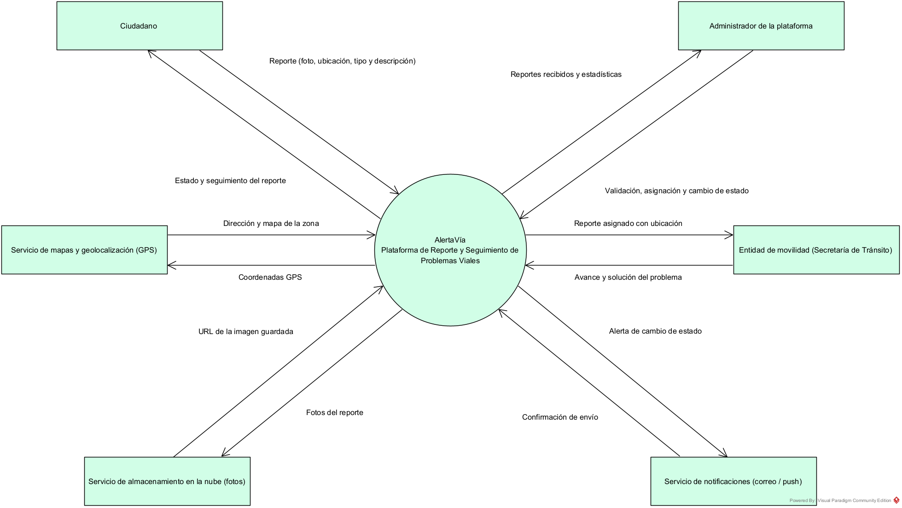
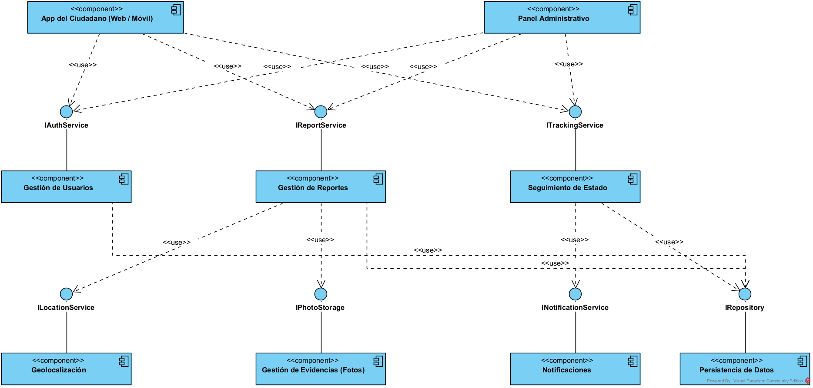
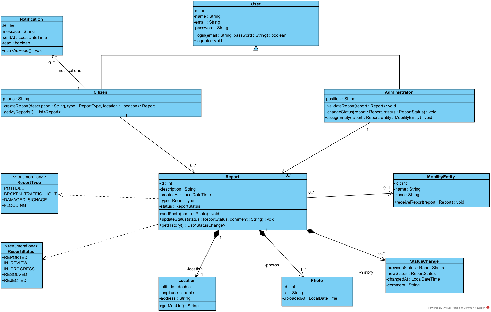
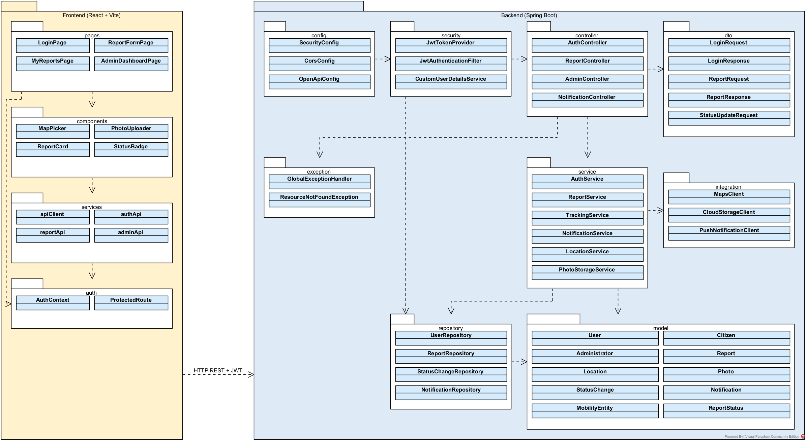
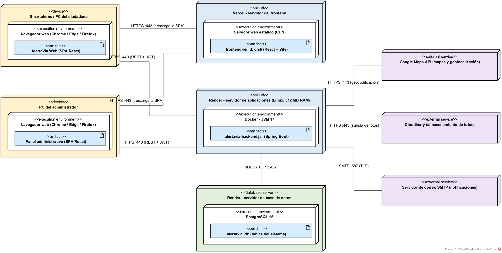

# AlertaVía – Plataforma de Reporte y Seguimiento de Problemas Viales

AlertaVía es una aplicación web para que los ciudadanos reporten problemas en las vías de la ciudad (huecos, semáforos dañados, señalización deteriorada e inundaciones) adjuntando una foto y la ubicación del lugar. La plataforma organiza los reportes, los asigna a la entidad de movilidad encargada y permite hacer seguimiento a su estado hasta que el problema queda resuelto.

**[Ver la aplicación desplegada](https://alertavia.vercel.app)** · **[API (Swagger)](https://alertavia-backend.onrender.com/swagger-ui.html)** · **[Wiki del proyecto](https://github.com/Santiago425/AlertaVia-Diseno-de-Software/wiki)**

> El backend está en el plan gratuito de Render: si lleva un rato sin uso, la primera petición puede tardar cerca de un minuto mientras el servidor arranca.

## Funcionalidades principales

- Registro e inicio de sesión de ciudadanos y administradores (JWT).
- Creación de reportes con tipo de problema, descripción, foto y ubicación GPS.
- Ubicación del reporte en el mapa y conversión de coordenadas a dirección.
- Seguimiento del estado del reporte: Reportado, En revisión, En proceso, Resuelto o Rechazado.
- Historial de cambios de estado de cada reporte.
- Panel administrativo para validar reportes, cambiar su estado y asignarlos a una entidad de movilidad.
- Notificaciones al ciudadano cuando su reporte cambia de estado.
- Estadísticas de reportes para el administrador.

## Tecnologías

| Capa | Tecnología |
|------|------------|
| Frontend | React + Vite (desplegado en Vercel) |
| Backend | Java 17 + Spring Boot, API REST con JWT (desplegado en Render) |
| Base de datos | PostgreSQL |
| Mapas y geolocalización | Google Maps API |
| Almacenamiento de fotos | Cloudinary |
| Notificaciones | Firebase Cloud Messaging / SMTP |
| Modelado | Visual Paradigm |

## Vistas de arquitectura (modelo 4+1)

| Vista | Pregunta que responde | Diagrama |
|-------|-----------------------|----------|
| 1. Contexto | ¿Con quién se comunica el sistema? | [Imagen](diagramas/imagenes/vista-1-contexto.png) · [.vpp](diagramas/vpp/vista-1-contexto.vpp) |
| 2. Funcional | ¿Qué componentes tiene y qué servicios ofrece cada uno? | [Imagen](diagramas/imagenes/vista-2-funcional.png) · [.vpp](diagramas/vpp/vista-2-funcional.vpp) |
| 3. Lógica | ¿Qué clases maneja el sistema y cómo se relacionan? | [Imagen](diagramas/imagenes/vista-3-logica.png) · [.vpp](diagramas/vpp/vista-3-logica.vpp) |
| 4. Desarrollo | ¿Cómo se organiza el código en paquetes y capas? | [Imagen](diagramas/imagenes/vista-4-desarrollo.png) · [.vpp](diagramas/vpp/vista-4-desarrollo.vpp) |
| 5. Despliegue | ¿Dónde se ejecuta cada parte del sistema? | [Imagen](diagramas/imagenes/vista-5-despliegue.png) · [.vpp](diagramas/vpp/vista-5-despliegue.vpp) |

El archivo [`AlertaVia.vpp`](diagramas/vpp/AlertaVia.vpp) contiene las cinco vistas en un solo proyecto. La explicación de cada diagrama está en la página **Diagramas de Arquitectura** de la wiki.

### Vista 1 – Contexto


### Vista 2 – Funcional


### Vista 3 – Lógica


### Vista 4 – Desarrollo


### Vista 5 – Despliegue


## Estructura del repositorio

```
AlertaVia-Diseno-de-Software/
├── README.md
├── docker-compose.yml        PostgreSQL + backend para correr en local
├── render.yaml               Despliegue del backend y la base de datos en Render
├── .github/workflows/ci.yml  Compilación y pruebas automáticas
├── backend/                  API REST (Java 17 + Spring Boot)
│   └── src/main/java/com/alertavia/
│       ├── config/           Seguridad, CORS, Swagger y datos iniciales
│       ├── security/         JWT y carga de usuarios
│       ├── controller/       Endpoints REST
│       ├── dto/              Objetos de entrada y salida
│       ├── exception/        Manejo global de errores
│       ├── service/          Lógica de negocio
│       ├── integration/      Google Maps, Cloudinary y notificaciones
│       ├── repository/       Acceso a datos con Spring Data JPA
│       └── model/            Entidades del dominio (vista lógica)
├── frontend/                 Aplicación web (React + Vite)
│   └── src/
│       ├── pages/            Login, nuevo reporte, mis reportes y panel admin
│       ├── components/       Mapa, fotos, tarjeta de reporte y estado
│       ├── services/         Cliente de la API
│       └── auth/             Sesión y rutas protegidas
├── diagramas/
│   ├── vpp/                  Proyectos de Visual Paradigm (uno por vista y uno con todas)
│   └── imagenes/             Diagramas exportados en PNG
└── wiki/                     Copia de las páginas de la wiki
```

Los paquetes del backend y del frontend son los mismos de la **vista de desarrollo**, y las clases de `model` son las de la **vista lógica**.

## Cómo ejecutar el proyecto en local

**Requisitos:** Java 17, Maven, Node.js 20 o superior y PostgreSQL (o Docker).

1. Levantar la base de datos y el backend con Docker:
   ```bash
   docker compose up --build
   ```
   O, sin Docker, crear la base `alertavia_db` en PostgreSQL y ejecutar:
   ```bash
   cd backend
   mvn spring-boot:run
   ```
   La API queda en `http://localhost:8080` y la documentación Swagger en `http://localhost:8080/swagger-ui.html`.

2. Levantar el frontend:
   ```bash
   cd frontend
   cp .env.example .env
   npm install
   npm run dev
   ```
   La aplicación queda en `http://localhost:5173`.

Al iniciar, el backend crea las entidades de movilidad y dos cuentas de prueba, que también aparecen en la pantalla de inicio:

| Rol | Usuario | Contraseña |
|-----|---------|------------|
| Administrador | `admin@alertavia.com` | `admin123` |
| Ciudadano | `ciudadano@alertavia.com` | `ciudadano123` |

Los demás ciudadanos se registran desde la pantalla de inicio.

### Pruebas

```bash
cd backend
mvn verify
```

Las pruebas revisan el flujo de estados del reporte y el recorrido completo: registro, creación del reporte con foto, validación por el administrador, asignación a la entidad y notificación al ciudadano.

## Despliegue

| Parte | Plataforma | Configuración |
|-------|------------|---------------|
| Backend (Docker) | Render | `render.yaml` y `backend/Dockerfile` |
| Base de datos | Render PostgreSQL | `render.yaml` |
| Frontend | Vercel | Carpeta raíz `frontend`, variable `VITE_API_URL` con la URL del backend |

Variables de entorno del backend (ver `backend/.env.example`): `DATABASE_HOST`, `DATABASE_PORT`, `DATABASE_NAME`, `DATABASE_USERNAME`, `DATABASE_PASSWORD`, `JWT_SECRET` (mínimo 32 caracteres), `ADMIN_PASSWORD`, `CORS_ALLOWED_ORIGINS`, `GOOGLE_MAPS_API_KEY`, `CLOUDINARY_CLOUD_NAME`, `CLOUDINARY_API_KEY`, `CLOUDINARY_API_SECRET` y los datos `SMTP_*` para enviar correos. Si no se configuran Cloudinary o SMTP, las fotos se guardan en el servidor y las notificaciones quedan solo dentro de la aplicación.

## API REST

| Método | Ruta | Rol | Descripción |
|--------|------|-----|-------------|
| POST | `/api/auth/register` | Público | Registro de ciudadano |
| POST | `/api/auth/login` | Público | Inicio de sesión (devuelve el JWT) |
| GET | `/api/auth/me` | Autenticado | Datos del usuario actual |
| POST | `/api/reports` | Ciudadano | Crear reporte con fotos (multipart) |
| GET | `/api/reports/mine` | Ciudadano | Reportes del ciudadano |
| GET | `/api/reports/{id}` | Autenticado | Detalle e historial de un reporte |
| GET | `/api/notifications` | Ciudadano | Notificaciones del ciudadano |
| PATCH | `/api/notifications/{id}/read` | Ciudadano | Marcar notificación como leída |
| GET | `/api/admin/reports` | Administrador | Todos los reportes (filtro opcional por estado) |
| PUT | `/api/admin/reports/{id}/status` | Administrador | Cambiar el estado del reporte |
| PUT | `/api/admin/reports/{id}/entity/{entityId}` | Administrador | Asignar entidad de movilidad |
| GET | `/api/admin/entities` | Administrador | Entidades de movilidad |
| GET | `/api/admin/statistics` | Administrador | Estadísticas de reportes |

## Cómo abrir los diagramas

1. Instalar Visual Paradigm (la edición Community es suficiente).
2. Abrir cualquier archivo `.vpp` de la carpeta `diagramas/vpp` con doble clic o desde **Project → Open**.

## Autor

**Santiago Campoverde**
Universidad Cooperativa de Colombia – Diseño de Software
