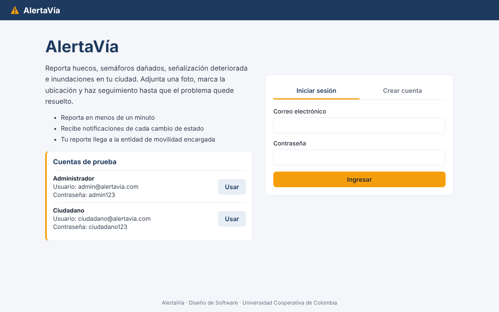
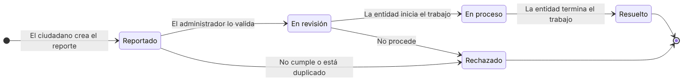
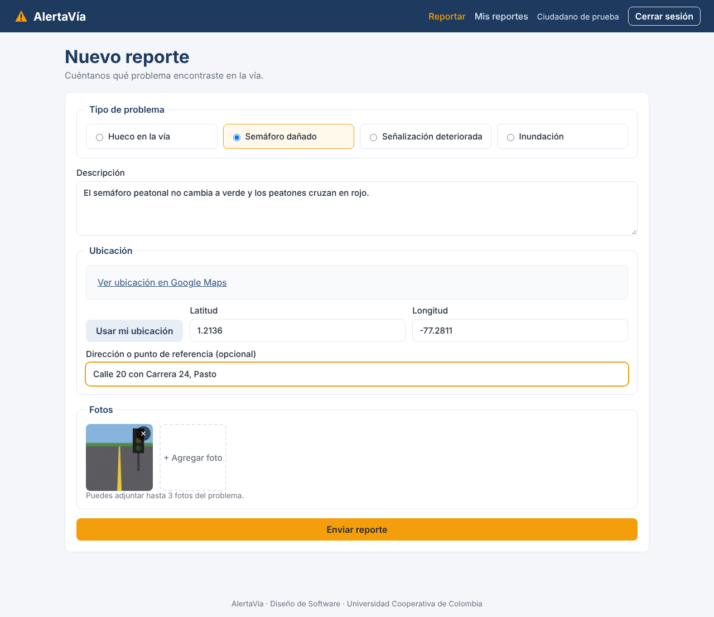
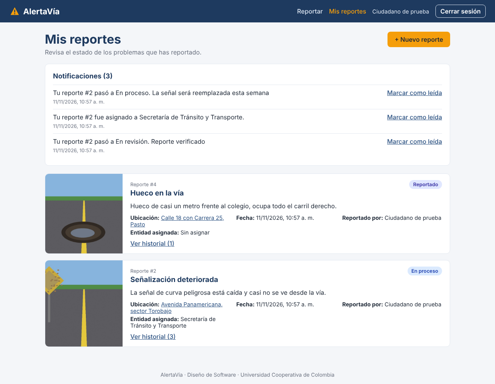
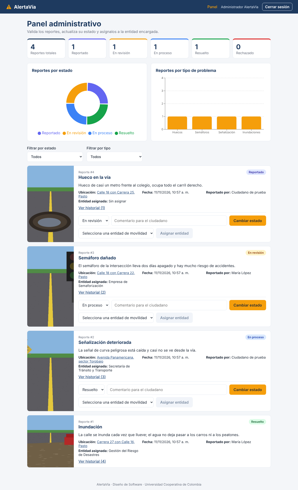
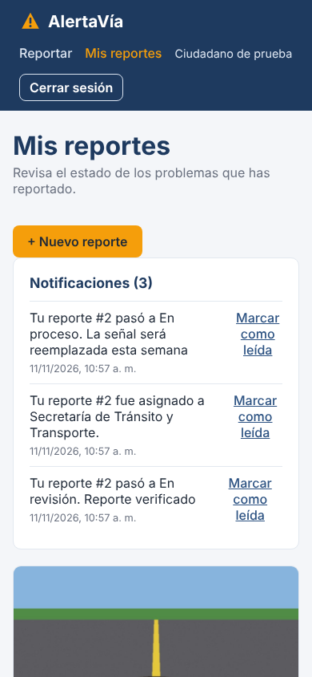

# 🚧 AlertaVía – Plataforma de Reporte y Seguimiento de Problemas Viales

[](https://github.com/Santiago425/AlertaVia-Diseno-de-Software/actions/workflows/ci.yml)
[](https://openjdk.org/projects/jdk/17/)
[](https://spring.io/projects/spring-boot)
[](https://react.dev/)
[](https://www.mongodb.com/)
[](https://alertavia-backend.onrender.com/swagger-ui.html)
[](https://alertavia.vercel.app)

AlertaVía es una aplicación web para que los ciudadanos reporten problemas en las vías de la ciudad (huecos, semáforos dañados, señalización deteriorada e inundaciones) adjuntando fotos y la ubicación del lugar. La plataforma organiza los reportes, los asigna a la entidad de movilidad encargada y permite hacer seguimiento a su estado hasta que el problema queda resuelto.

| 🌐 Aplicación | 📡 API (Swagger) | 📚 Wiki | 📝 Historias de usuario | 📄 Implementación |
|:---:|:---:|:---:|:---:|:---:|
| [alertavia.vercel.app](https://alertavia.vercel.app) | [alertavia-backend.onrender.com](https://alertavia-backend.onrender.com/swagger-ui.html) | [Ver wiki](https://github.com/Santiago425/AlertaVia-Diseno-de-Software/wiki) | [Ver issues](https://github.com/Santiago425/AlertaVia-Diseno-de-Software/issues) | [Resumen](IMPLEMENTATION_SUMMARY.md) |



## 📑 Contenido

- [Cuentas de prueba](#-cuentas-de-prueba)
- [Características principales](#-características-principales)
- [Tecnologías](#-tecnologías)
- [Arquitectura (modelo 4+1)](#️-arquitectura-modelo-41)
- [Capturas](#-capturas)
- [Estructura del repositorio](#-estructura-del-repositorio)
- [Modelo de datos en MongoDB](#-modelo-de-datos-en-mongodb)
- [Ejecución local](#-ejecución-local)
- [Pruebas](#-pruebas)
- [Despliegue](#-despliegue)
- [Endpoints REST](#-endpoints-rest)
- [Seguridad](#-seguridad)
- [Autor](#-autor)

## 🔑 Cuentas de prueba

Las cuentas aparecen también en la pantalla de inicio, con un botón que llena el formulario.

| Rol | Usuario | Contraseña |
|-----|---------|------------|
| Administrador | `admin@alertavia.com` | `admin123` |
| Ciudadano | `ciudadano@alertavia.com` | `ciudadano123` |

> El backend está en el plan gratuito de Render. El workflow `keep-alive.yml` lo visita cada 10 minutos entre las 6:00 a. m. y las 10:00 p. m. (hora de Colombia) para que no se apague; fuera de ese horario la primera petición puede tardar cerca de un minuto.

## 🚀 Características principales

**Ciudadano**
- Registro e inicio de sesión con JWT.
- Creación de reportes con tipo de problema, descripción, hasta 3 fotos y ubicación (GPS, mapa o coordenadas).
- Dirección obtenida automáticamente a partir de las coordenadas con Google Maps.
- Consulta de sus reportes con el estado actual y el historial de cambios.
- Notificaciones en la aplicación y por correo cuando el reporte cambia de estado o es asignado.

**Administrador**
- Panel con indicadores y gráficas (Recharts) de reportes por estado y por tipo de problema.
- Filtros de reportes por estado y por tipo.
- Validación o rechazo de reportes con comentario para el ciudadano.
- Asignación del reporte a la entidad de movilidad encargada.
- Seguimiento del flujo de estados: **Reportado → En revisión → En proceso → Resuelto** (o **Rechazado**).

## 🧰 Tecnologías

| Capa | Tecnología |
|------|------------|
| Frontend | React 18 + Vite, React Router y Recharts (desplegado en Vercel) |
| Backend | Java 17 + Spring Boot 3: Web, Data MongoDB, Security, Validation y Mail (desplegado en Render con Docker) |
| Seguridad | JWT y BCrypt |
| Base de datos | MongoDB 7 (MongoDB Atlas en producción) |
| Mapas y geolocalización | Google Maps API |
| Almacenamiento de fotos | Cloudinary |
| Notificaciones | En la aplicación y por correo SMTP |
| Documentación de la API | Swagger (springdoc-openapi) |
| Pruebas e integración continua | JUnit 5, Mockito, MockMvc, Testcontainers y GitHub Actions |
| Entorno de desarrollo | Maven Wrapper, Docker Compose y Dev Container |
| Modelado | Visual Paradigm |

## 🏗️ Arquitectura (modelo 4+1)

| Vista | Pregunta que responde | Diagrama |
|-------|-----------------------|----------|
| 1. Contexto | ¿Con quién se comunica el sistema? | [Imagen](diagramas/imagenes/vista-1-contexto.png) · [.vpp](diagramas/vpp/vista-1-contexto.vpp) |
| 2. Funcional | ¿Qué componentes tiene y qué servicios ofrece cada uno? | [Imagen](diagramas/imagenes/vista-2-funcional.png) · [.vpp](diagramas/vpp/vista-2-funcional.vpp) |
| 3. Lógica | ¿Qué clases maneja el sistema y cómo se relacionan? | [Imagen](diagramas/imagenes/vista-3-logica.png) · [.vpp](diagramas/vpp/vista-3-logica.vpp) |
| 4. Desarrollo | ¿Cómo se organiza el código en paquetes y capas? | [Imagen](diagramas/imagenes/vista-4-desarrollo.png) · [.vpp](diagramas/vpp/vista-4-desarrollo.vpp) |
| 5. Despliegue | ¿Dónde se ejecuta cada parte del sistema? | [Imagen](diagramas/imagenes/vista-5-despliegue.png) · [.vpp](diagramas/vpp/vista-5-despliegue.vpp) |

El archivo [`AlertaVia.vpp`](diagramas/vpp/AlertaVia.vpp) tiene las cinco vistas en un solo proyecto. Para abrirlos se necesita Visual Paradigm (la edición Community es suficiente). La explicación de cada diagrama está en la página [Diagramas de Arquitectura](https://github.com/Santiago425/AlertaVia-Diseno-de-Software/wiki/6).-Diagramas-de-Arquitectura) de la wiki.

Los paquetes del código son los mismos de la **vista de desarrollo** y las clases de `model` son las de la **vista lógica**.

<details>
<summary><b>Ver los cinco diagramas</b></summary>

### Vista 1 – Contexto


### Vista 2 – Funcional


### Vista 3 – Lógica


### Vista 4 – Desarrollo


### Vista 5 – Despliegue


</details>

**Flujo de estados del reporte**



## 📸 Capturas

| Nuevo reporte | Mis reportes |
|:---:|:---:|
|  |  |
| **Panel administrativo** | **Vista en celular** |
|  |  |

## 📁 Estructura del repositorio

```
AlertaVia-Diseno-de-Software/
├── backend/                     API REST (Java 17 + Spring Boot)
│   ├── Dockerfile
│   ├── mvnw / mvnw.cmd          Maven Wrapper
│   └── src/main/java/com/alertavia/
│       ├── config/              Seguridad, CORS, Swagger y datos iniciales
│       ├── security/            JWT y carga de usuarios
│       ├── controller/          Endpoints REST
│       ├── dto/                 Objetos de entrada y salida
│       ├── exception/           Manejo global de errores
│       ├── service/             Lógica de negocio
│       ├── integration/         Google Maps, Cloudinary y correo
│       ├── repository/          Acceso a datos con Spring Data MongoDB
│       └── model/               Entidades del dominio (vista lógica)
├── frontend/                    Aplicación web (React + Vite), con Dockerfile y nginx
│   └── src/
│       ├── pages/               Inicio de sesión, nuevo reporte, mis reportes y panel admin
│       ├── components/          Mapa, fotos, tarjeta de reporte y estado
│       ├── services/            Cliente de la API
│       └── auth/                Sesión y rutas protegidas
├── diagramas/
│   ├── vpp/                     Proyectos de Visual Paradigm (uno por vista y uno con todas)
│   └── imagenes/                Diagramas exportados en PNG
├── docs/                        Capturas de la aplicación y diagramas de flujo
├── wiki/                        Copia de las páginas de la wiki
├── .github/workflows/          ci.yml (compilación y pruebas) y keep-alive.yml (mantiene el backend activo)
├── .devcontainer/               Entorno listo para VS Code o Codespaces
├── docker-compose.yml           Sistema completo en contenedores (MongoDB, mongo-express, backend y frontend)
├── run.sh                       Levanta todo el proyecto en local con un comando
├── IMPLEMENTATION_SUMMARY.md    Resumen de lo implementado y su relación con los diagramas
└── render.yaml                  Despliegue del backend y la base de datos en Render
```

## 🍃 Modelo de datos en MongoDB

La aplicación usa **MongoDB** con **Spring Data MongoDB**. Cada clase raíz del dominio es un documento en su propia colección:

| Colección | Clase | Qué guarda |
|-----------|-------|------------|
| `users` | `User` → `Citizen` / `Administrator` | Ciudadanos y administradores en la misma colección; el campo `_class` (`CITIZEN` o `ADMIN`) indica el tipo, igual que el discriminador `tipo` del ejemplo de la editorial. |
| `reports` | `Report` | El reporte con su ubicación, fotos e historial **embebidos**. |
| `notifications` | `Notification` | Las notificaciones de cada ciudadano. |
| `mobility_entities` | `MobilityEntity` | Las entidades de movilidad a las que se asignan los reportes. |

**Decisiones de diseño:**
- **Composición → documentos embebidos.** `Location`, `Photo` y `StatusChange` solo existen dentro de un reporte, por eso se guardan dentro del documento `reports` y se leen en una sola consulta.
- **Asociación → referencia por id.** El reporte guarda `citizenId`, `reviewedById` y `mobilityEntityId` (y una copia del nombre para mostrarlo sin otra consulta), porque el ciudadano y la entidad tienen vida propia.
- **Herencia → una colección con discriminador.** `Citizen` y `Administrator` heredan de `User` y se guardan juntos en `users`.
- **Índices:** correo único en `users`, nombre único en `mobility_entities` e índices por estado, tipo y ciudadano en `reports`.

Ejemplo de documento en la colección `reports`:

```json
{
  "_id": "6730f1c2a9e4b5d8c1f2a3b4",
  "description": "Hueco de casi un metro frente al colegio",
  "type": "POTHOLE",
  "status": "IN_REVIEW",
  "createdAt": "2026-11-12T10:57:00",
  "location": { "latitude": 1.2136, "longitude": -77.2811, "address": "Calle 18 con Carrera 25, Pasto" },
  "citizenId": "6730f0a1...", "citizenName": "Ciudadano de prueba",
  "mobilityEntityId": "6730ef90...", "mobilityEntityName": "Secretaría de Infraestructura",
  "photos": [ { "url": "https://res.cloudinary.com/.../hueco.jpg", "uploadedAt": "2026-11-12T10:57:00" } ],
  "history": [
    { "previousStatus": null, "newStatus": "REPORTED", "comment": "Reporte creado por el ciudadano", "changedAt": "..." },
    { "previousStatus": "REPORTED", "newStatus": "IN_REVIEW", "comment": "Reporte verificado", "changedAt": "..." }
  ]
}
```

## 🔧 Ejecución local

**Requisitos:** Java 17, Node.js 20 o superior y Docker (o MongoDB instalado). No hace falta instalar Maven: el proyecto trae el Maven Wrapper.

### 1. Clonar el repositorio

```bash
git clone https://github.com/Santiago425/AlertaVia-Diseno-de-Software.git
cd AlertaVia-Diseno-de-Software
```

### 2. Opción rápida: un solo comando

```bash
./run.sh
```

Levanta MongoDB (con Docker si no está corriendo), el backend y el frontend, y muestra los enlaces y las cuentas de prueba.

### 3. Opción con Docker Compose (todo en contenedores)

```bash
docker compose up --build
```

| Servicio | URL |
|----------|-----|
| Frontend | `http://localhost:3000` |
| Backend | `http://localhost:8080` |
| Swagger | `http://localhost:8080/swagger-ui.html` |
| mongo-express (ver la base de datos) | `http://localhost:8081` |

### 4. Opción manual

```bash
# Backend (con MongoDB corriendo en localhost:27017)
cd backend
./mvnw spring-boot:run

# Frontend, en otra terminal
cd frontend
cp .env.example .env
npm install
npm run dev
```

La aplicación queda en `http://localhost:5173` y la API en `http://localhost:8080`.

### 5. Dev Container

El proyecto se puede abrir en **VS Code → Reopen in Container** o en **GitHub Codespaces**: el contenedor trae Java 17, Node 20 y Docker, y descarga las dependencias automáticamente.

Al iniciar, el backend crea las entidades de movilidad y las cuentas de prueba.

## 🧪 Pruebas

```bash
cd backend
./mvnw verify
```

**42 pruebas, 0 fallos:**

| Clase | Tipo | Qué verifica |
|-------|------|--------------|
| `ReportTest` | Unitaria | Flujo de estados, asignación de entidad, código corto, URL del mapa y notificaciones |
| `ReportStatusTest` | Unitaria parametrizada | Transiciones permitidas y prohibidas y etiquetas en español |
| `AuthServiceTest` | Unitaria (Mockito) | Registro, correo duplicado (409), normalización del correo, roles y usuario inexistente |
| `TrackingServiceTest` | Unitaria (Mockito) | Cambio de estado, notificaciones, transición inválida y asignación |
| `PhotoStorageServiceTest` | Unitaria (Mockito) | Mínimo una foto, máximo tres y solo imágenes |
| `LocationServiceTest` | Unitaria (Mockito) | Dirección escrita, Google Maps y coordenadas de respaldo |
| `AlertaViaApplicationTests` | Integración (MockMvc + MongoDB real con Testcontainers) | Recorrido completo por la API con permisos por rol, 409 por correo repetido y 404 |

GitHub Actions ejecuta las pruebas, compila el frontend y construye las imágenes Docker en cada push.

## ☁️ Despliegue

| Parte | Plataforma | Configuración |
|-------|------------|---------------|
| Backend (Docker) | Render | `render.yaml` y `backend/Dockerfile` |
| Base de datos | MongoDB Atlas (clúster gratuito M0) | Variable `MONGODB_URI` en Render |
| Frontend | Vercel | Carpeta raíz `frontend` y variable `VITE_API_URL` con la URL del backend |

Cada push a `main` vuelve a desplegar el backend y el frontend.

Variables de entorno del backend (ver `backend/.env.example`): `MONGODB_URI`, `JWT_SECRET` (mínimo 32 caracteres), `CORS_ALLOWED_ORIGINS`, `ADMIN_PASSWORD`, `GOOGLE_MAPS_API_KEY`, `CLOUDINARY_CLOUD_NAME`, `CLOUDINARY_API_KEY`, `CLOUDINARY_API_SECRET` y `SMTP_*`. Si no se configuran Cloudinary o SMTP, las fotos se guardan en el servidor y las notificaciones quedan solo dentro de la aplicación.

## 📡 Endpoints REST

| Método | Ruta | Rol | Descripción |
|--------|------|-----|-------------|
| POST | `/api/auth/register` | Público | Registro de ciudadano |
| POST | `/api/auth/login` | Público | Inicio de sesión (devuelve el JWT) |
| GET | `/api/auth/me` | Autenticado | Datos del usuario actual |
| POST | `/api/reports` | Ciudadano | Crear reporte con fotos (multipart) |
| GET | `/api/reports/mine` | Ciudadano | Reportes del ciudadano |
| GET | `/api/reports/{id}` | Autenticado | Detalle e historial de un reporte |
| GET | `/api/notifications` | Ciudadano | Notificaciones del ciudadano |
| PATCH | `/api/notifications/{id}/read` | Ciudadano | Marcar notificación como leída |
| GET | `/api/admin/reports?status=&type=` | Administrador | Reportes con filtros opcionales por estado y tipo |
| PUT | `/api/admin/reports/{id}/status` | Administrador | Cambiar el estado del reporte |
| PUT | `/api/admin/reports/{id}/entity/{entityId}` | Administrador | Asignar entidad de movilidad |
| GET | `/api/admin/entities` | Administrador | Entidades de movilidad |
| GET | `/api/admin/statistics` | Administrador | Estadísticas de reportes |

## 🔐 Seguridad

- Autenticación sin estado con **JWT** en el encabezado `Authorization: Bearer`.
- Control de acceso por rol: las rutas `/api/admin/**` solo aceptan administradores y las de reportes propios solo ciudadanos.
- Contraseñas cifradas con **BCrypt**.
- Validación de datos de entrada y de archivos (solo imágenes, máximo 5 MB y 3 fotos por reporte).
- CORS limitado al dominio del frontend y secretos en variables de entorno.

## 👤 Autor

**Santiago Campoverde**
Universidad Cooperativa de Colombia – Diseño de Software
