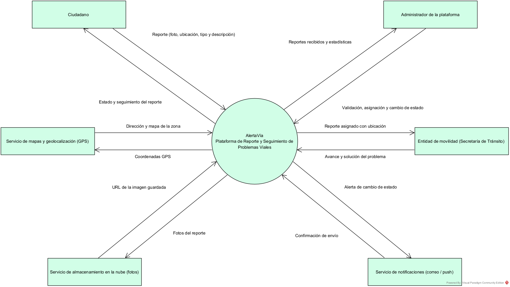
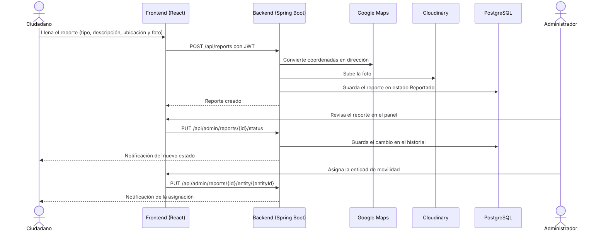
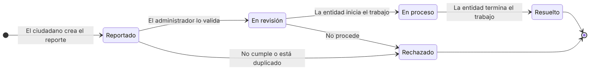

### 2.1 Perspectiva del producto

AlertaVía es un sistema nuevo e independiente. Funciona como **intermediario entre la ciudadanía y las entidades de movilidad**: recibe los reportes de problemas viales, los organiza y le muestra a cada ciudadano el avance de la atención. No reemplaza los procesos internos de las entidades; les entrega los reportes con evidencia y ubicación y deja registro de cada cambio.

Se apoya en servicios externos para los mapas (Google Maps), el almacenamiento de fotos (Cloudinary) y el envío de notificaciones (correo SMTP).

**Actores principales:**

* Ciudadano
* Administrador
* *(Sistema externo)* Entidad de movilidad
* *(Sistemas externos)* Google Maps, Cloudinary y servidor de correo

---

### 2.2 Funciones del producto

**Funciones principales:**

* **Gestión de usuarios:** registro de ciudadanos, inicio y cierre de sesión con JWT y roles de ciudadano y administrador.
* **Gestión de reportes:** creación de reportes con tipo de problema, descripción, hasta 3 fotos y ubicación.
* **Geolocalización:** captura de coordenadas con el GPS o el mapa y conversión de coordenadas a dirección.
* **Gestión de evidencias:** subida de las fotos a Cloudinary y almacenamiento de su URL.
* **Seguimiento de estado:** flujo de estados controlado y registro del historial de cada reporte.
* **Asignación:** envío del reporte a la entidad de movilidad que lo debe atender.
* **Notificaciones:** aviso al ciudadano, en la aplicación y por correo, cuando su reporte cambia de estado o es asignado.
* **Estadísticas:** total de reportes, cantidad por estado y por tipo de problema.

**Flujo general:**

1. El ciudadano llena el reporte: tipo de problema, descripción, ubicación y foto.
2. El frontend envía el reporte al backend con el token JWT del ciudadano.
3. El backend obtiene la dirección con Google Maps (si el ciudadano no la escribió) y sube la foto a Cloudinary.
4. El reporte se guarda en PostgreSQL con estado **Reportado**.
5. El administrador revisa el reporte en el panel, lo valida o lo rechaza y lo asigna a una entidad de movilidad.
6. Cada cambio queda en el historial y genera una notificación para el ciudadano.
7. Cuando la entidad termina el trabajo, el administrador marca el reporte como **Resuelto**.

**Estados del reporte:**

---

### 2.3 Tipos de usuario y características

- **Ciudadano:**
  Persona que reporta problemas viales desde su celular o computador. No necesita conocimientos técnicos.
  * Se registra por su cuenta con nombre, correo y contraseña.
  * Crea reportes con foto y ubicación.
  * Consulta sus reportes, el estado actual y el historial de cambios.
  * Recibe notificaciones cuando su reporte avanza.
  * Solo puede ver sus propios reportes.

- **Administrador:**
  Funcionario encargado de revisar los reportes que llegan a la plataforma.
  * Ve todos los reportes de la ciudad y los filtra por estado y tipo.
  * Valida o rechaza reportes dejando un comentario.
  * Asigna cada reporte a la entidad de movilidad que lo debe atender.
  * Actualiza el estado hasta que el problema queda resuelto.
  * Consulta las estadísticas de reportes.
  * Su cuenta la crea el sistema al iniciar; no se registra desde la aplicación.

- **Entidad de movilidad** *(actor externo)*:
  Organismo que atiende el problema (Secretaría de Tránsito y Transporte, Secretaría de Infraestructura, Gestión del Riesgo de Desastres o Empresa de Semaforización). Recibe los reportes asignados e informa su avance al administrador.

---

### 2.4 Entorno operativo

**Requisitos del lado del cliente:**

- Celular o computador con un navegador actualizado: Google Chrome, Microsoft Edge o Mozilla Firefox.
- Conexión a internet.
- Permiso de ubicación (opcional; también se puede marcar el punto en el mapa o escribir las coordenadas).
- Cámara o galería de fotos para la evidencia.
- No requiere instalar ninguna aplicación.

**Requisitos del servidor:**

- **Frontend:** React 18 + Vite, publicado en **Vercel**.
- **Backend:** Java 17 con Spring Boot 3, ejecutado en un contenedor **Docker** en **Render**.
- **Base de datos:** **PostgreSQL 16** en Render.
- **Servicios externos:** Google Maps API, Cloudinary y servidor de correo SMTP.

---

### 2.5 Restricciones de diseño y operación

- **Tecnologías:** el backend está construido en **Java con Spring Boot** y sigue una arquitectura por capas (controller, service, repository, model); el frontend usa **React**.
- **Seguridad:** las rutas protegidas exigen un token **JWT** válido y cada rol solo accede a sus funciones.
- **Contraseñas:** se guardan cifradas con **BCrypt**, nunca en texto plano.
- **Fotos:** no se guardan en la base de datos; solo se guarda su URL.
- **Comunicación:** toda la comunicación en producción se hace por **HTTPS**.
- **Idioma:** el código (clases, métodos y variables) se escribe en inglés y la interfaz y la documentación en español.
- **Costos:** el proyecto usa los planes gratuitos de Render y Vercel.

---

### 2.6 Guía de uso del sistema

#### Para el ciudadano

1. Entra a la aplicación, se registra en **Crear cuenta** o inicia sesión.
2. En **Nuevo reporte** elige el tipo de problema y escribe la descripción.
3. Presiona **Usar mi ubicación** o marca el punto en el mapa; si quiere, escribe una dirección de referencia.
4. Adjunta entre 1 y 3 fotos del problema.
5. Presiona **Enviar reporte** y lo ve en **Mis reportes** con estado *Reportado*.
6. Revisa las notificaciones y el historial para conocer el avance.

#### Para el administrador

1. Inicia sesión y entra al **Panel administrativo**.
2. Revisa las estadísticas y filtra los reportes por estado o tipo.
3. Valida (*En revisión*) o rechaza cada reporte nuevo con un comentario.
4. Asigna el reporte a la entidad de movilidad correspondiente.
5. Cambia el estado a *En proceso* y luego a *Resuelto* a medida que la entidad avanza.

---

### 2.7 Supuestos y dependencias

- El ciudadano tiene conexión a internet y un dispositivo con GPS o la posibilidad de marcar la ubicación.
- Los servicios de Google Maps, Cloudinary y correo están disponibles y con credenciales válidas; si no están configurados, el sistema sigue funcionando (coordenadas sin dirección, fotos en el servidor y notificaciones solo en la aplicación).
- Las entidades de movilidad aceptan recibir los reportes por medio de la plataforma.
- El plan gratuito de Render apaga el backend cuando no se usa, por lo que la primera petición puede tardar cerca de un minuto.
