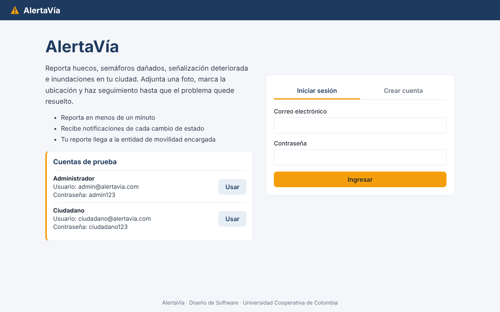
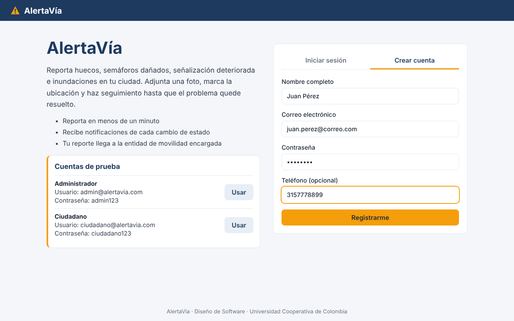
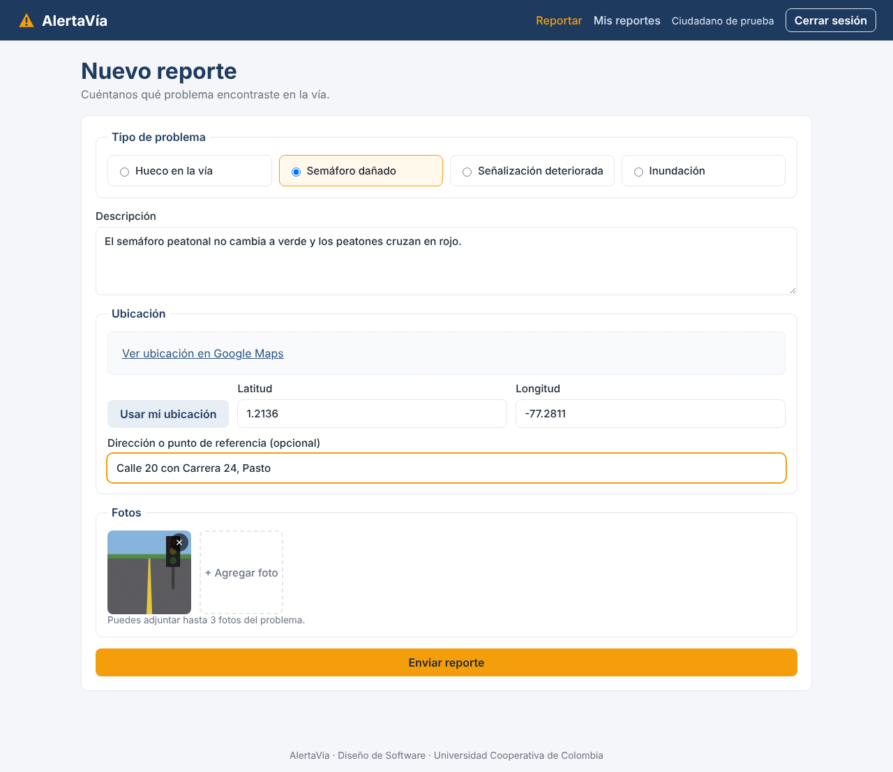
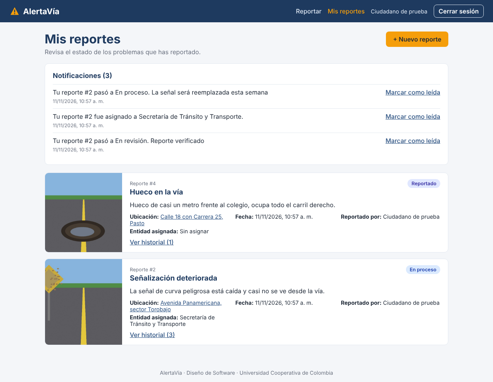
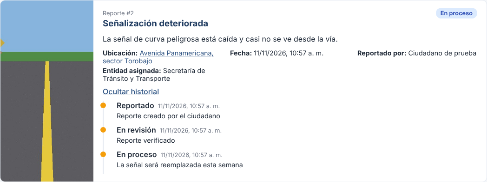
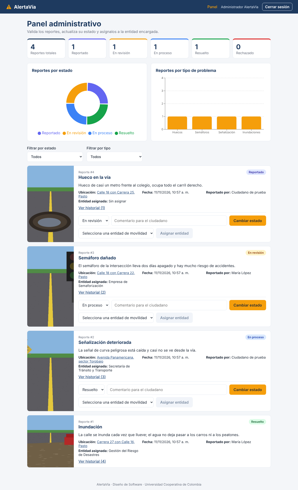
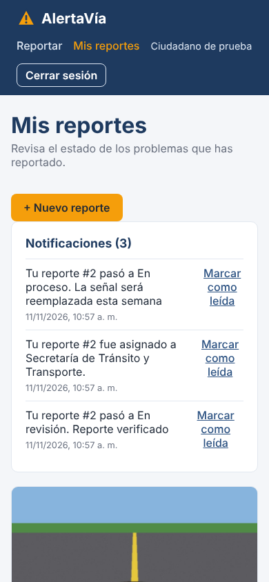

### 3.1 Interfaces de usuario

**Características principales:**

* Aplicación web adaptable a celular y computador, con pantallas diferenciadas por rol:
  * Ciudadano → crear reportes, consultar su estado e historial y ver notificaciones.
  * Administrador → panel con estadísticas, filtros y gestión de reportes.
* Diseño en modo claro con los colores de la marca (azul oscuro y amarillo de señal vial).
* Cada estado tiene su color: azul violeta para *Reportado*, amarillo para *En revisión*, azul para *En proceso*, verde para *Resuelto* y rojo para *Rechazado*.
* **Mensajes de error:** en español y junto al formulario (por ejemplo, *"Correo o contraseña incorrectos"* o *"Adjunta al menos una foto del problema."*).
* **Confirmaciones:** mensaje al enviar un reporte (*"Tu reporte #N fue enviado correctamente"*) y actualización inmediata de la tarjeta al cambiar un estado.

**Pantallas principales:**

**Inicio de sesión y cuentas de prueba**

**Registro de ciudadano**

**Nuevo reporte (Ciudadano)** – tipo de problema, descripción, ubicación y fotos.

**Mis reportes (Ciudadano)** – notificaciones, lista de reportes y estado.

**Historial del reporte**

**Panel administrativo** – estadísticas, filtros, cambio de estado y asignación.

**Vista en celular**

---

### 3.2 Interfaces de hardware

* **Cámara** del dispositivo para tomar la foto del problema (en el celular se abre la cámara trasera).
* **GPS** del dispositivo para obtener la latitud y la longitud.
* No se requiere hardware especial en el servidor; el backend y la base de datos corren en la nube (Render).

---

### 3.3 Interfaces de software

| Sistema externo | Uso en AlertaVía | Clase que lo usa | Protocolo |
|-----------------|------------------|------------------|-----------|
| **Google Maps API** | Mostrar el mapa en el formulario y convertir coordenadas en dirección (geocodificación inversa). | `MapsClient` | HTTPS |
| **Cloudinary** | Guardar las fotos de los reportes y devolver su URL pública. | `CloudStorageClient` | HTTPS |
| **Servidor SMTP** | Enviar correos de notificación al ciudadano. | `PushNotificationClient` | SMTP con TLS |
| **MongoDB Atlas** | Guardar usuarios, reportes (con fotos e historial embebidos), notificaciones y entidades. | Repositorios de Spring Data MongoDB | MongoDB / TCP 27017 con TLS |

---

### 3.4 Interfaces de comunicación

* El frontend se comunica con el backend por medio de una **API REST** sobre **HTTPS** con datos en **JSON**.
* La creación de reportes usa `multipart/form-data`: una parte `report` con el JSON del reporte y una o más partes `photos` con las imágenes.
* Las peticiones a rutas protegidas incluyen el encabezado `Authorization: Bearer <token>`.
* El backend solo acepta peticiones del dominio del frontend (CORS configurado con `CORS_ALLOWED_ORIGINS`).
* La documentación interactiva de la API está en [Swagger](https://alertavia-backend.onrender.com/swagger-ui.html).

| Método | Endpoint | Descripción | Rol |
|--------|----------|-------------|-----|
| POST | `/api/auth/register` | Registro de ciudadano | Público |
| POST | `/api/auth/login` | Inicio de sesión (devuelve el JWT) | Público |
| GET | `/api/auth/me` | Datos del usuario actual | Autenticado |
| POST | `/api/reports` | Crear reporte con fotos | Ciudadano |
| GET | `/api/reports/mine` | Listar mis reportes | Ciudadano |
| GET | `/api/reports/{id}` | Detalle e historial de un reporte | Ciudadano / Administrador |
| GET | `/api/notifications` | Notificaciones del ciudadano | Ciudadano |
| PATCH | `/api/notifications/{id}/read` | Marcar notificación como leída | Ciudadano |
| GET | `/api/admin/reports?status=&type=` | Listar reportes con filtros | Administrador |
| PUT | `/api/admin/reports/{id}/status` | Cambiar estado | Administrador |
| PUT | `/api/admin/reports/{id}/entity/{entityId}` | Asignar a entidad de movilidad | Administrador |
| GET | `/api/admin/entities` | Entidades de movilidad | Administrador |
| GET | `/api/admin/statistics` | Estadísticas de reportes | Administrador |
