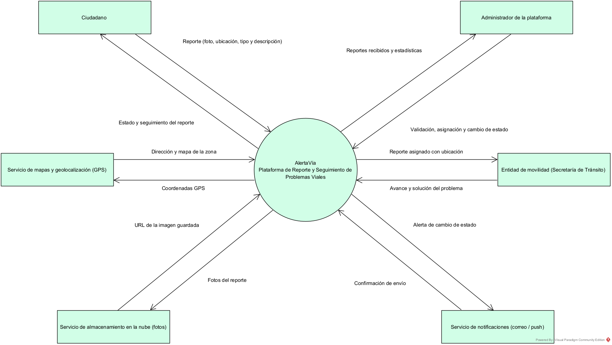
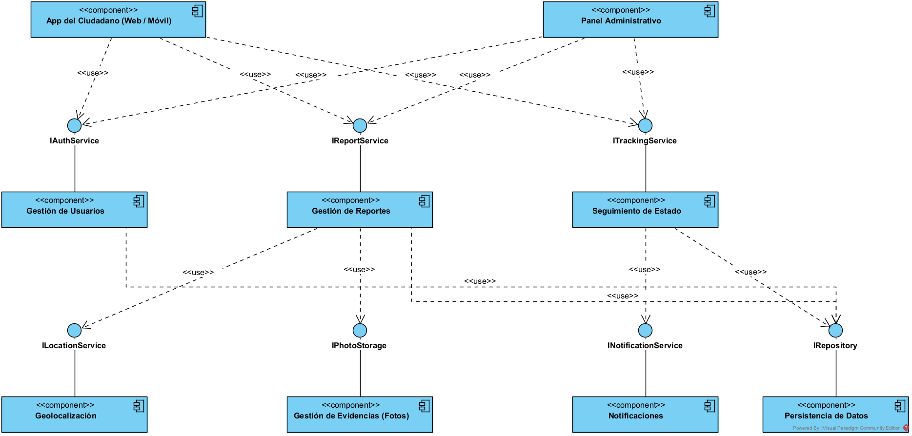
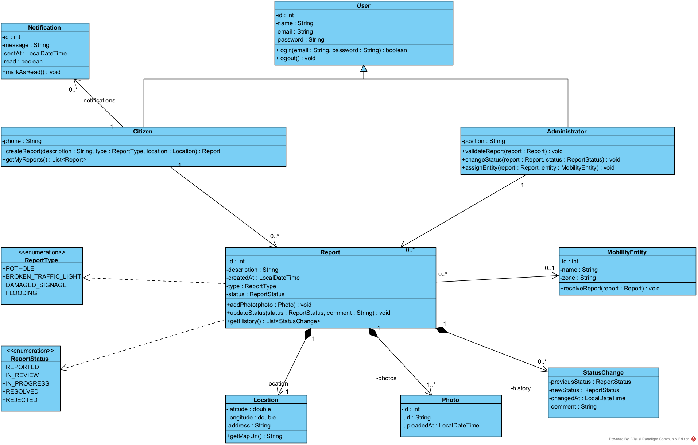
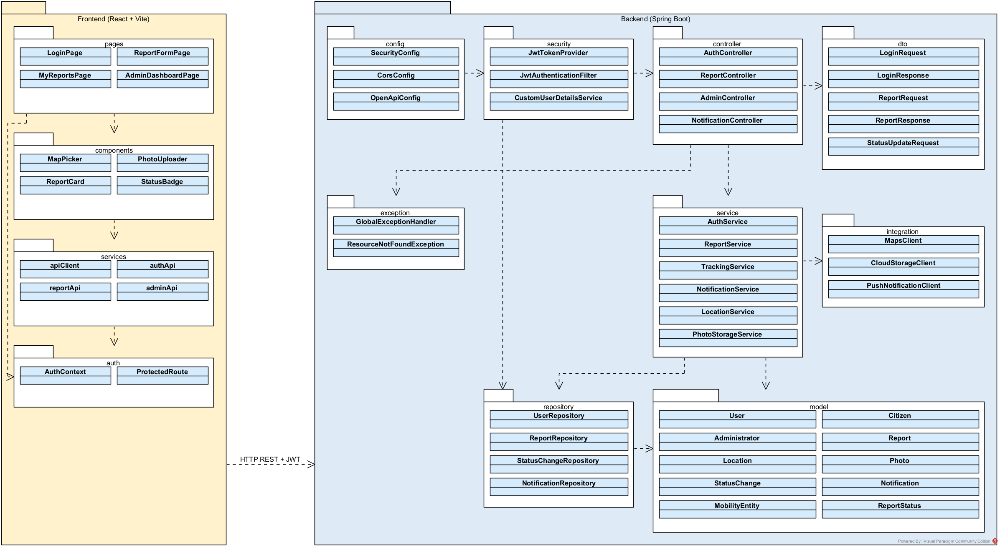
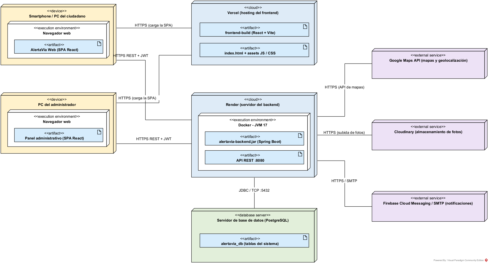

> Vistas arquitectónicas del sistema **AlertaVía** siguiendo el modelo **4+1 de Kruchten**.
> Cada vista responde una pregunta diferente sobre el sistema. Los archivos `.vpp` de Visual Paradigm están en la carpeta [`diagramas/vpp`](https://github.com/Santiago425/AlertaVia-Diseno-de-Software/tree/main/diagramas/vpp) del repositorio.

---

## Vista 1 — Contexto

**¿Con quién se comunica el sistema?**

Muestra AlertaVía como una caja negra en el centro y las entidades externas con las que intercambia información: el ciudadano, el administrador de la plataforma, la entidad de movilidad, el servicio de mapas, el servicio de almacenamiento de fotos y el servicio de notificaciones. Cada flecha indica qué dato entra o sale del sistema, por ejemplo el reporte con foto y ubicación que envía el ciudadano o el avance que informa la entidad de movilidad.

La base de datos no aparece como entidad externa porque hace parte del sistema.



---

## Vista 2 — Funcional (Componentes)

**¿Qué partes tiene el sistema y qué servicios ofrece cada una?**

Divide el sistema en componentes que se comunican por interfaces:

- **App del Ciudadano** y **Panel Administrativo** usan los servicios de autenticación (`IAuthService`), reportes (`IReportService`) y seguimiento (`ITrackingService`).
- **Gestión de Reportes** se apoya en **Geolocalización** (`ILocationService`) y **Gestión de Evidencias** (`IPhotoStorage`).
- **Seguimiento de Estado** usa **Notificaciones** (`INotificationService`) para avisar al ciudadano.
- **Persistencia de Datos** ofrece `IRepository` a los componentes que guardan información.

Las líneas sólidas con círculo indican la interfaz que ofrece cada componente y las flechas «use» indican qué componente la consume.



---

## Vista 3 — Lógica (Clases)

**¿Qué clases maneja el sistema y cómo se relacionan?**

- **Herencia:** `Citizen` y `Administrator` heredan de la clase abstracta `User`.
- **Composición:** un `Report` está compuesto por su `Location`, sus `Photo` y su historial de `StatusChange`. Si se elimina el reporte, se eliminan sus partes.
- **Asociaciones:** un ciudadano crea varios reportes y recibe varias `Notification`; un administrador gestiona reportes; un reporte puede asignarse a una `MobilityEntity`.
- **Enumeraciones:** `ReportType` (tipo de problema) y `ReportStatus` (estado del reporte).



---

## Vista 4 — Desarrollo (Paquetes)

**¿Cómo está organizado el código?**

Diagrama de paquetes con la organización del frontend y del backend:

```
Frontend (React + Vite)
    └── pages → components → services → auth

Backend (Spring Boot)
    └── controller → service → repository → model
    └── dto, integration y exception como apoyo
    └── config y security transversales

Frontend ──HTTP REST + JWT──> Backend
```

- Cada capa solo depende de la capa inmediatamente inferior.
- `integration` agrupa los clientes de los servicios externos (`MapsClient`, `CloudStorageClient`, `PushNotificationClient`), así la lógica de negocio no depende directamente de Google Maps, Cloudinary o Firebase.
- `dto` define los objetos que viajan entre frontend y backend, para no exponer las entidades del modelo.



---

## Vista 5 — Despliegue

**¿Dónde se ejecuta cada parte del sistema?**

| Componente | Dónde corre | Comunicación |
|------------|-------------|--------------|
| App del ciudadano y panel administrativo | Navegador web del celular o computador | HTTPS |
| Frontend (React + Vite) | Vercel | HTTPS (carga la SPA) |
| Backend (Spring Boot, JVM 17) | Contenedor Docker en Render | HTTPS REST + JWT, puerto 8080 |
| Base de datos | Servidor PostgreSQL | JDBC / TCP, puerto 5432 |
| Mapas | Google Maps API | HTTPS |
| Fotos | Cloudinary | HTTPS |
| Notificaciones | Firebase Cloud Messaging / SMTP | HTTPS / SMTP |



---

## Resumen de patrones y principios aplicados

| Patrón / Principio | Dónde se aplica |
|--------------------|-----------------|
| **Arquitectura por capas** | controller → service → repository → model |
| **Repository** | `UserRepository`, `ReportRepository`, `StatusChangeRepository`, `NotificationRepository` |
| **DTO** | `LoginRequest`, `LoginResponse`, `ReportRequest`, `ReportResponse`, `StatusUpdateRequest` |
| **Herencia / Polimorfismo** | `User` → `Citizen`, `Administrator` |
| **Composición** | `Report` ◆ `Location`, `Photo`, `StatusChange` |
| **Adapter** | Clientes del paquete `integration` que aíslan los servicios externos |
| **SOLID – S** | Cada servicio tiene una sola responsabilidad (`AuthService`, `ReportService`, `NotificationService`…) |
| **SOLID – D** | Los componentes dependen de interfaces (`IReportService`, `IRepository`…) y no de implementaciones |
